# Mini Digital Library

Aplikasi web pengelolaan data buku perpustakaan, dibuat dengan **PHP Native (tanpa framework)**, **MySQL (mysqli prosedural)**, dan **Bootstrap 5** lewat CDN.
Tugas individu mata kuliah Pemrograman Web.

|                |                                |
| -------------- | ------------------------------ |
| **Nama**       | _MAYA PUSPA WARDHANI_          |
| **NIM**        | _2513020073_                   |
| **Video demo** | _https://youtu.be/AnMebPqhu24_ |

## Daftar Isi

- [Fitur](#fitur)
- [Teknologi](#teknologi)
- [Cara Menjalankan](#cara-menjalankan)
- [Struktur Project](#struktur-project)
- [Struktur Tabel Database](#struktur-tabel-database)
- [Screenshot](#screenshot)
- [Catatan Keamanan](#catatan-keamanan)

## Fitur

| Modul             | Rincian                                                                                                                                                                       |
| ----------------- | ----------------------------------------------------------------------------------------------------------------------------------------------------------------------------- |
| Login dan Session | Form login metode POST, password diverifikasi dengan `password_verify`. Semua halaman selain login dilindungi session; jika belum login, pengguna dialihkan ke `index.php`.   |
| Remember Me       | Cookie `username` berlaku 1 hari dan hanya dibuat jika checkbox dicentang. Jika cookie ada, halaman login langsung mengisi session dan masuk ke dashboard.                    |
| Logout            | Menghapus session (`unset` dan `session_destroy`) serta cookie Remember Me.                                                                                                   |
| CRUD Buku         | Tambah, tampil (tabel HTML), edit, dan hapus data buku, disertai pesan hasil proses.                                                                                          |
| Upload Sampul     | Hanya JPG/PNG, maksimal 2 MB, nama file dibuat unik. Saat edit, sampul lama diganti dan file lamanya dihapus. Saat buku dihapus, file gambarnya ikut dihapus dengan `unlink`. |
| Status Buku       | Ditentukan di PHP dengan if-else dari kolom `stok`: stok lebih dari 0 berstatus **Tersedia**, stok 0 berstatus **Dipinjam**.                                                  |
| Tambahan          | Kartu ringkasan (jumlah judul, total stok, tersedia, dipinjam), pencarian cepat di tabel, modal konfirmasi hapus, dan pratinjau sampul sebelum disimpan.                      |

## Teknologi

- PHP 8 (native, mysqli prosedural, tanpa framework)
- MySQL / MariaDB
- Bootstrap 5.3 dan Bootstrap Icons lewat CDN
- Server lokal: XAMPP

## Cara Menjalankan

1. Pasang XAMPP, lalu jalankan **Apache** dan **MySQL**.
2. Salin folder `project_perpustakaan` ke `C:\xampp\htdocs\`.
3. Buka `http://localhost/phpmyadmin`, pilih **Import**, lalu pilih file `db_perpustakaan.sql`. Database `db_perpustakaan` dibuat otomatis.
4. Pastikan pengaturan di `config/koneksi.php` sesuai (bawaan: `localhost`, user `root`, tanpa password).
5. Buka `http://localhost/project_perpustakaan/`.

**Akun bawaan:** username `admin`, password `admin123`.

> Folder `uploads/` harus ada dan bisa ditulis. File sampul contoh di dalamnya sesuai dengan nama file pada kolom `sampul` di data awal, jadi tampil langsung setelah database diimpor. Sampul buku yang kamu upload sendiri juga disimpan di folder ini.

## Struktur Project

```
project_perpustakaan/
├── config/
│   └── koneksi.php          # Koneksi ke database MySQL
├── screenshots/             # Gambar untuk README
├── uploads/                 # Folder penampung file sampul buku
├── index.php                # Halaman login (juga membaca cookie Remember Me)
├── proses_login.php         # Verifikasi login, membuat session dan cookie
├── logout.php               # Menghapus session dan cookie
├── dashboard.php            # Tampil data buku (Read)
├── tambah_buku.php          # Form tambah buku
├── proses_tambah.php        # INSERT dan upload sampul
├── edit_buku.php            # Form edit buku
├── proses_edit.php          # UPDATE dan penggantian sampul
├── hapus_buku.php           # DELETE dan unlink sampul
├── db_perpustakaan.sql      # Struktur dan data awal database
└── README.md
```

## Struktur Tabel Database

Database: `db_perpustakaan`

### Tabel `users`

| Kolom          | Tipe                         | Keterangan                  |
| -------------- | ---------------------------- | --------------------------- |
| `id`           | INT UNSIGNED, AUTO_INCREMENT | Primary key                 |
| `username`     | VARCHAR(50)                  | Unik                        |
| `password`     | VARCHAR(255)                 | Hash dari `password_hash()` |
| `nama_lengkap` | VARCHAR(100)                 |                             |

### Tabel `buku`

| Kolom          | Tipe                         | Keterangan                                                                 |
| -------------- | ---------------------------- | -------------------------------------------------------------------------- |
| `id`           | INT UNSIGNED, AUTO_INCREMENT | Primary key                                                                |
| `judul`        | VARCHAR(150)                 |                                                                            |
| `kategori`     | VARCHAR(50)                  |                                                                            |
| `penulis`      | VARCHAR(100)                 |                                                                            |
| `tahun_terbit` | SMALLINT UNSIGNED            |                                                                            |
| `stok`         | INT                          | Bawaan 0. Status "Tersedia" atau "Dipinjam" dihitung di PHP dari kolom ini |
| `sampul`       | VARCHAR(255)                 | Nama file di folder `uploads/`, kosong jika buku belum punya sampul        |
| `created_at`   | TIMESTAMP                    | Waktu data dibuat (otomatis)                                               |

## Screenshot

### 1. Login

Halaman login dengan kolom username, password, dan checkbox **Remember Me**.

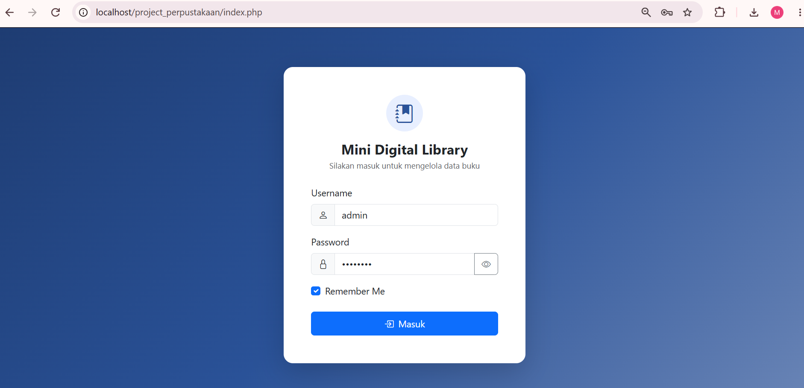

Jika username atau password salah, muncul pesan kesalahan dan pengguna tetap di halaman login.

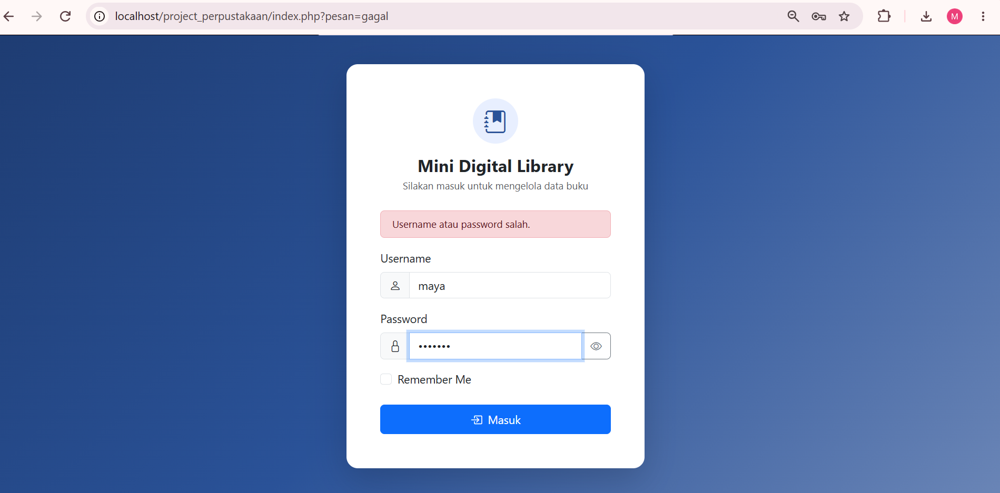

### 2. Dashboard (tampil data)

Tabel buku lengkap dengan sampul, kartu ringkasan, dan status **Tersedia** atau **Dipinjam** sesuai stok (stok 0 berstatus Dipinjam).

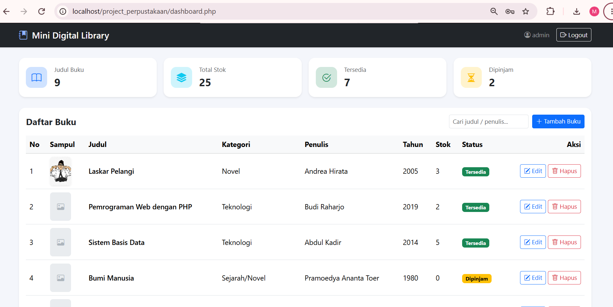

### 3. Tambah buku

Form tambah buku dengan pratinjau sampul yang langsung muncul setelah file dipilih.

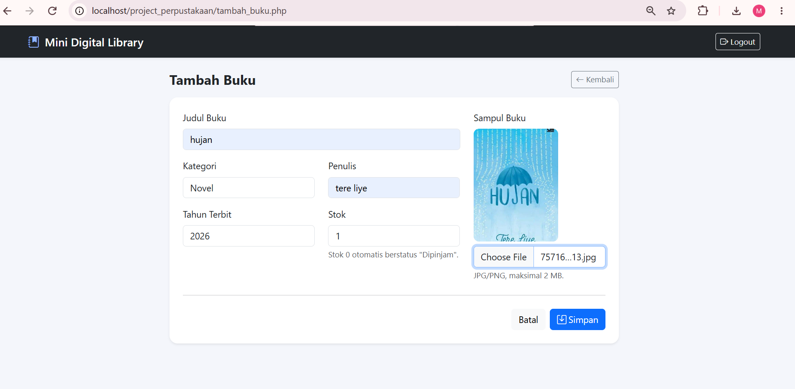

### 4. Edit buku

Form edit berisi data yang sudah ada. Memilih file baru menampilkan pratinjaunya; jika kolom file dikosongkan, sampul lama tetap dipakai.

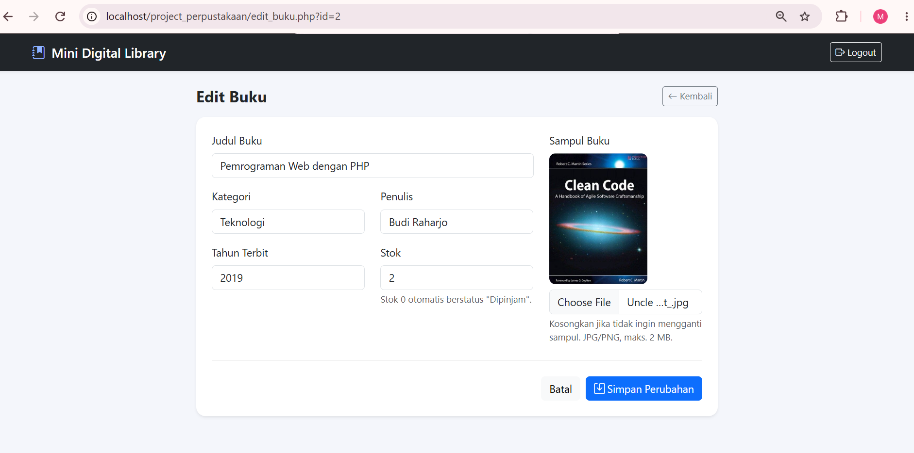

### 5. Hapus buku

Modal konfirmasi sebelum data dan file sampul dihapus permanen.

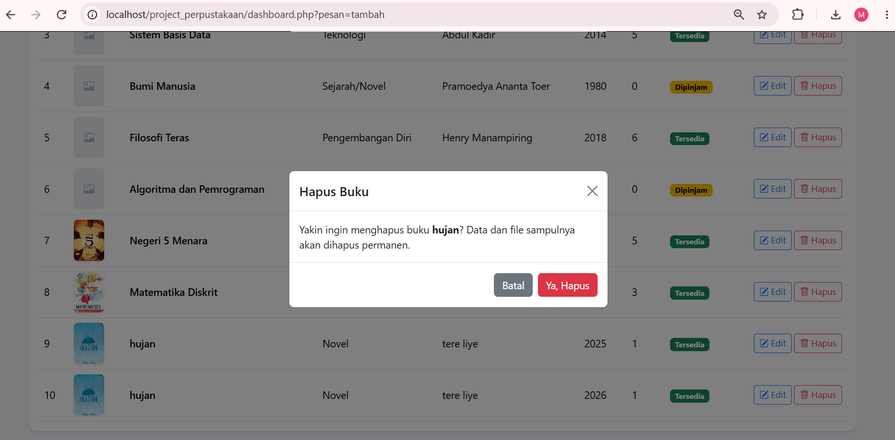

### 6. Validasi upload

File yang lebih besar dari 2 MB ditolak. Di browser, pemilihan file dibatalkan dengan peringatan. Di server, ukuran, ekstensi (JPG/PNG), dan isi file diperiksa ulang sehingga file yang tidak sesuai tidak pernah tersimpan.

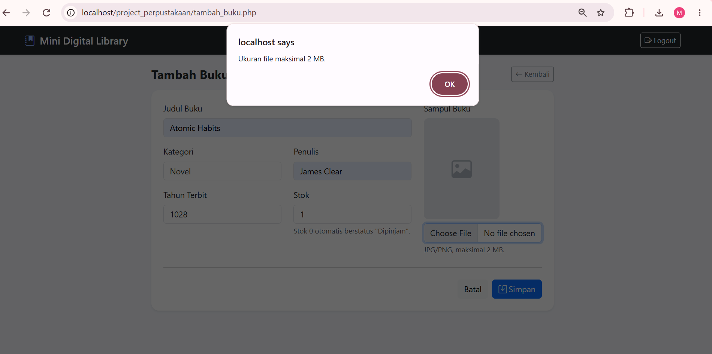

### 7. Database di phpMyAdmin

Tabel `users` berisi satu admin bawaan. Password tersimpan sebagai hash, bukan teks asli.

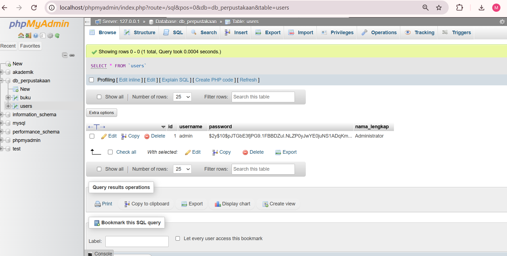

Tabel `buku` berisi data buku. Kolom `sampul` hanya menyimpan nama file.

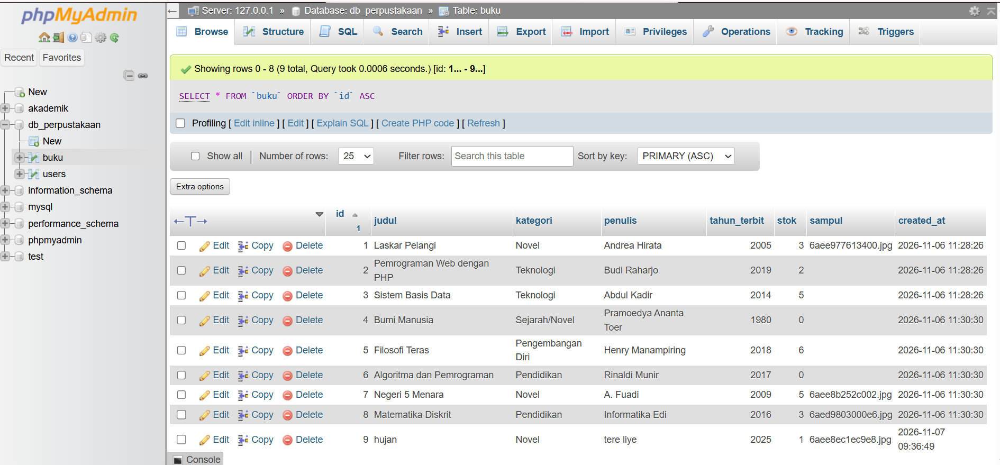

Detail kolom `sampul` di database:

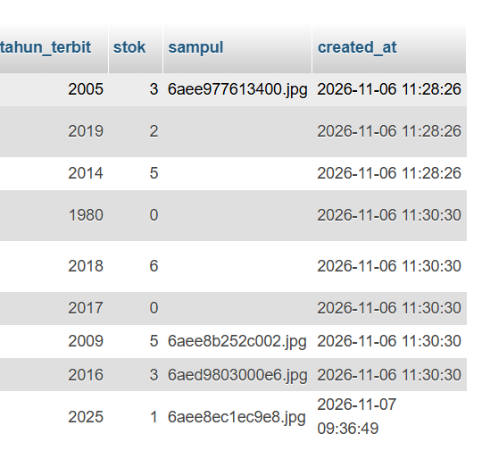

### 8. Folder uploads

Isi folder `uploads/` sesuai dengan nama file di kolom `sampul`. File dari buku yang sudah dihapus tidak tersisa karena dihapus dengan `unlink`.

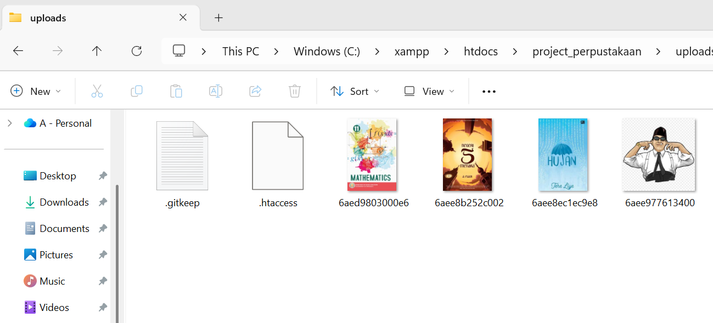

## Catatan Keamanan

- Password disimpan sebagai hash (`password_hash`) dan dicocokkan dengan `password_verify`.
- Input teks diproses dengan `mysqli_real_escape_string`, ID diubah ke integer dengan `intval`, dan data yang ditampilkan di halaman diproses dengan `htmlspecialchars`.
- Upload divalidasi di server: ekstensi (`pathinfo`), ukuran (maksimal 2 MB), dan isi file (`getimagesize`).
- Nama file sampul dibuat unik dengan `uniqid()` agar tidak bentrok.
- Folder `uploads/` memiliki `.htaccess` agar file PHP di dalamnya tidak bisa dijalankan.
- Setiap `header("location: ...")` diikuti `exit;` agar kode di bawahnya tidak ikut berjalan.
